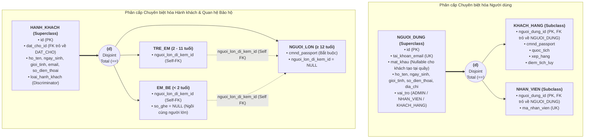

# THIẾT KẾ CƠ SỞ DỮ LIỆU: HỆ THỐNG QUẢN LÝ PHÒNG BÁN VÉ MÁY BAY
**Phiên bản:** 2.2 (Chuẩn hóa toàn diện & Đạt chuẩn 3NF)  
**Tài liệu căn cứ:** SRS v1.2, Wireframe UI Figma, Kiến trúc dữ liệu hàng không  
**Chuẩn hóa:** 3NF & Financial Point-in-time Snapshot | RDBMS: MySQL 8.0+

---

## 1. SƠ ĐỒ QUAN HỆ THỰC THỂ (ERD - ENTITY RELATIONSHIP DIAGRAM)

Sơ đồ ERD chuẩn hóa 19 thực thể, luồng liên kết không bị trùng lặp, đạt chuẩn 3NF và thể hiện rõ ràng các ràng buộc toàn vẹn:

```mermaid
erDiagram
    SAN_BAY ||--o{ CHUYEN_BAY : "khoi hanh tai (1-N)"
    SAN_BAY ||--o{ CHUYEN_BAY : "ha canh tai (1-N)"
    SAN_BAY ||--o{ DIEM_DEN : "phuc vu diem den (1-N)"
    HANG_HANG_KHONG ||--o{ CHUYEN_BAY : "khai thac (1-N)"
    
    CHUYEN_BAY ||--|{ HANG_VE_CHUYEN_BAY : "co cac hang ve (1-N)"
    
    NGUOI_DUNG ||--o| KHACH_HANG : "chuyen biet hoa (1-1)"
    NGUOI_DUNG ||--o| NHAN_VIEN : "chuyen biet hoa (1-1)"
    NGUOI_DUNG ||--o{ XAC_THUC_TOKEN : "so huu token (1-N)"
    NGUOI_DUNG ||--o{ AUDIT_LOG : "phat sinh nhat ky (1-N)"
    NGUOI_DUNG ||--o{ TIN_TUC : "dang tin (1-N)"
    NGUOI_DUNG ||--o{ TIN_NHAN_CHAT : "gui/nhan chat (1-N)"
    
    KHACH_HANG ||--o{ DAT_CHO : "thuc hien dat (1-N)"
    NHAN_VIEN ||--o{ DAT_CHO : "lap don tai quay (1-N)"
    
    DAT_CHO ||--o{ THANH_TOAN : "duoc thanh toan qua (1-N)"
    DAT_CHO ||--|{ HANH_KHACH : "danh sach nguoi bay (1-N)"
    DAT_CHO ||--|{ VE_MAY_BAY : "gom cac ve (1-N)"
    
    HANH_KHACH ||--|{ VE_MAY_BAY : "so huu ve tung chieu (1-N)"
    HANH_KHACH ||--o{ HANH_KHACH : "nguoi lon bao ho em be/tre em (1-N)"
    
    HANG_VE_CHUYEN_BAY ||--o{ VE_MAY_BAY : "ap dung hang ve (1-N)"
    GOI_HANH_LY ||--o{ VE_MAY_BAY : "mua them theo chieu (1-N)"
    
    VE_MAY_BAY ||--o{ VE_DICH_VU : "dat them dich vu (1-N)"
    DICH_VU_CHUYEN_BAY ||--o{ VE_DICH_VU : "danh muc ap dung (1-N)"

    SAN_BAY {
        string ma_san_bay PK "Mã IATA (DAD, SGN, HAN)"
        string ten_san_bay "Tên sân bay"
        string thanh_pho "Tỉnh / Thành phố"
        string quoc_gia "Quốc gia"
    }

    HANG_HANG_KHONG {
        string ma_hang PK "Mã hãng (VN, VJ, QH, BL)"
        string ten_hang "Tên hãng bay"
        string logo_url "Đường dẫn logo"
        string trang_thai "HOAT_DONG / TAM_NGUNG"
    }

    CHUYEN_BAY {
        bigint id PK "ID chuyến bay"
        string ma_chuyen_bay "Số hiệu (VN236, VJ202)"
        string ma_hang FK "Mã hãng bay"
        string ma_san_bay_di FK "Sân bay cất cánh"
        string ma_san_bay_den FK "Sân bay hạ cánh"
        datetime thoi_gian_khoi_hanh "Ngày giờ cất cánh"
        datetime thoi_gian_ha_canh "Ngày giờ hạ cánh (hỗ trợ qua đêm)"
        string trang_thai "DUNG_GIO, DELAY, DA_HUY"
    }

    HANG_VE_CHUYEN_BAY {
        bigint id PK "ID hạng vé"
        bigint chuyen_bay_id FK "Thuộc chuyến bay"
        string loai_khoang "PHO_THONG / THUONG_GIA"
        decimal gia_goc "Giá gốc hãng"
        decimal gia_ban "Giá bán niêm yết"
        decimal thue_phi "Thuế phí sân bay"
        int hanh_ly_xach_tay_kg "Xách tay miễn cước (10kg)"
        int hanh_ly_ky_gui_kg "Ký gửi miễn cước (23kg)"
        int tong_so_ghe "Tổng ghế"
        int so_ghe_trong "Số ghế còn trống"
    }

    NGUOI_DUNG {
        bigint id PK "ID người dùng"
        string tai_khoan_email UK "Email đăng nhập"
        string mat_khau "Mật khẩu băm (Nullable cho khách tạo tại quầy)"
        string ho_ten "Họ và tên"
        date ngay_sinh "Ngày sinh"
        string gioi_tinh "Nam / Nu / Khac"
        string so_dien_thoai "VARCHAR(20) Chuẩn E.164 (+)"
        string dia_chi "Địa chỉ liên lạc"
        string anh_dai_dien "Avatar URL"
        string vai_tro "ADMIN, NHAN_VIEN, KHACH_HANG (Vai trò duy nhất)"
    }

    KHACH_HANG {
        bigint nguoi_dung_id PK, FK "ID người dùng tham chiếu NGUOI_DUNG"
        string cmnd_passport "CMND/CCCD/Passport"
        string quoc_tich "Quốc tịch"
        string xep_hang "Member, Silver, Gold, Diamond"
        int diem_tich_luy "Điểm tích lũy"
    }

    NHAN_VIEN {
        bigint nguoi_dung_id PK, FK "ID người dùng tham chiếu NGUOI_DUNG"
        string ma_nhan_vien UK "Mã NV quản lý (NV1, ADMIN1)"
    }

    DAT_CHO {
        bigint id PK "ID đơn đặt chỗ"
        string ma_dat_cho UK "Mã PNR đặt chỗ 6-10 ký tự"
        bigint khach_hang_id FK "Khách hàng đặt (Nullable)"
        bigint nhan_vien_id FK "Nhân viên lập phiếu (Nullable)"
        string email_nguoi_dat "Email đại diện"
        string so_dien_thoai_nguoi_dat "VARCHAR(20) SĐT người đặt"
        string ho_ten_nguoi_dat "Tên người đặt"
        string loai_chuyen_bay "MOT_CHIEU / KHU_HOI"
        int so_nguoi_lon "Snapshot số người lớn"
        int so_tre_em "Snapshot số trẻ em"
        int so_em_be "Snapshot số em bé"
        datetime ngay_dat "Thời điểm đặt"
        decimal tong_gia_goc "Snapshot tổng giá gốc"
        decimal tong_gia_ban "Snapshot tổng tiền bán"
        string trang_thai "CHO_THANH_TOAN, DA_THANH_TOAN, DA_HUY"
    }

    HANH_KHACH {
        bigint id PK "ID hành khách"
        bigint dat_cho_id FK "Thuộc đơn đặt chỗ"
        string ho_ten "Họ và tên hành khách"
        date ngay_sinh "Ngày sinh (Bắt buộc kiểm tra độ tuổi)"
        string gioi_tinh "Nam / Nu / Khac"
        string email "Email liên hệ"
        string so_dien_thoai "VARCHAR(20) SĐT hành khách"
        string cmnd_passport "CMND/Passport (Bắt buộc người lớn)"
        string loai_hanh_khach "NGUOI_LON, TRE_EM, EM_BE"
        bigint nguoi_lon_di_kem_id FK "ID người lớn bảo hộ (Self-FK)"
    }

    GOI_HANH_LY {
        int id PK "Mã gói hành lý"
        int so_kg "Khối lượng: 15, 20, 23, 30 kg"
        decimal gia_tien "Cước phí mua thêm"
        string mo_ta "Mô tả gói hành lý"
    }

    VE_MAY_BAY {
        bigint id PK "ID vé máy bay"
        string ma_ve UK "Mã vé (DN001, HCM001...)"
        bigint dat_cho_id FK "Thuộc đơn đặt chỗ"
        bigint hanh_khach_id FK "Thuộc hành khách nào"
        bigint hang_ve_id FK "Hạng vé chuyến bay (Đã chứa chuyến bay)"
        int goi_hanh_ly_id FK "Gói hành lý mua riêng cho chiều này"
        string chieu_bay "CHIEU_DI / CHIEU_VE"
        string so_ghe "Số ghế (Nullable nếu là em bé ngồi cùng)"
        decimal gia_goc "Snapshot giá gốc"
        decimal gia_ban "Snapshot giá bán"
        decimal thue_phi "Snapshot thuế phí"
        decimal cuoc_hanh_ly "Snapshot cước hành lý chiều này"
        decimal tong_gia "Snapshot tổng tiền vé này"
        boolean da_in_ve "Đã in vé tại quầy"
        string trang_thai "CHO_THANH_TOAN, DA_THANH_TOAN, DA_HUY"
    }

    DICH_VU_CHUYEN_BAY {
        bigint id PK "ID dịch vụ"
        string ten_dich_vu "Suất ăn nóng, Chọn chỗ ngồi sớm, Lounge..."
        string mo_ta "Mô tả dịch vụ"
        decimal gia_tien "Đơn giá dịch vụ"
        string trang_thai "HOAT_DONG / TAM_NGUNG"
    }

    VE_DICH_VU {
        bigint id PK "ID chi tiết dịch vụ"
        bigint ve_id FK "Gắn với vé từng chiều"
        bigint dich_vu_id FK "Thuộc danh mục dịch vụ"
        int so_luong "Số lượng đặt"
        decimal thanh_tien "Snapshot thành tiền"
    }

    THANH_TOAN {
        bigint id PK "ID giao dịch"
        string ma_giao_dich UK "Mã giao dịch nội bộ"
        bigint dat_cho_id FK "Đơn đặt chỗ thanh toán"
        string phuong_thuc "PAYPAL, VNPAY, MOMO, TIEN_MAT"
        decimal so_tien "Số tiền thanh toán"
        datetime thoi_gian_thanh_toan "Thời điểm thanh toán"
        string ma_giao_dich_doi_tac "Mã GD phản hồi từ cổng thanh toán"
        string trang_thai "CHO_XU_LY, THANH_CONG, THAT_BAI, DA_HOAN_TIEN (Mặc định CHO_XU_LY)"
        string ghi_chu "Ghi chú Gateway"
    }

    XAC_THUC_TOKEN {
        bigint id PK "ID token"
        bigint user_id FK "Thuộc người dùng"
        string token_hash UK "Băm SHA-256 bảo mật"
        string loai_token "XAC_THUC_EMAIL / QUEN_MAT_KHAU"
        boolean da_su_dung "Kiểm soát dùng 1 lần (Mặc định FALSE)"
        datetime het_han "Thời gian hết hạn"
    }

    AUDIT_LOG {
        bigint id PK "ID log"
        bigint user_id FK "ID người dùng thực hiện"
        string hanh_dong "LOGIN, TAO_VE, XOA_VE..."
        string chi_tiet "Chi tiết thao tác"
        datetime thoi_gian "Thời điểm ghi nhận"
        string ip "Địa chỉ IP người dùng"
    }

    TIN_TUC {
        bigint id PK "ID bài viết"
        bigint nguoi_dung_id FK "Tác giả đăng bài"
        string loai_tin "KHUYEN_MAI, QUY_DINH_HANH_LY, GIOI_THIEU, THONG_BAO (Theo menu Figma)"
        string tieu_de "Tiêu đề tin tức / khuyến mãi"
        string noi_dung "Nội dung bài viết"
        string anh_dai_dien "Ảnh bìa bài viết"
        string trang_thai "HIEN_THI, AN (Mặc định HIEN_THI)"
        datetime thoi_gian_tao "Thời gian đăng"
    }

    DIEM_DEN {
        bigint id PK "ID điểm đến"
        string ten_diem_den "Tên danh lam thắng cảnh"
        string ma_san_bay FK "Sân bay lân cận"
        string mo_ta "Giới thiệu điểm đến"
        string hinh_anh "Ảnh minh họa"
    }

    TIN_NHAN_CHAT {
        bigint id PK "ID tin nhắn"
        bigint nguoi_gui_id FK "Người gửi"
        bigint nguoi_nhan_id FK "Người nhận"
        string noi_dung "Nội dung chat tư vấn"
        datetime gui_luc "Thời điểm gửi"
        boolean da_doc "Trạng thái đã đọc"
    }
```



---

## 2. SƠ ĐỒ THỰC THỂ MỞ RỘNG (EER DIAGRAM)

### 2.1. Phân cấp NGUOI_DUNG (Disjoint, Total Specialization)
- **Superclass:** `NGUOI_DUNG` (quản lý thông tin đăng nhập, hồ sơ cá nhân và vai trò tập trung).
- **Discriminator:** `vai_tro` (`ADMIN`, `NHAN_VIEN`, `KHACH_HANG`).
- **Subclasses:**
  - `KHACH_HANG`: Khóa chính/ngoại `nguoi_dung_id`, mở rộng `cmnd_passport`, `quoc_tich`, `xep_hang`, `diem_tich_luy`.
  - `NHAN_VIEN`: Khóa chính/ngoại `nguoi_dung_id`, mở rộng `ma_nhan_vien` (UK). Xóa bỏ trường `quyen` để tránh sai lệch dữ liệu phân quyền.

### 2.2. Phân cấp & Quan hệ HANH_KHACH
- **Superclass:** `HANH_KHACH` (quản lý danh sách người bay theo đơn đặt chỗ `dat_cho_id`, có thêm `ngay_sinh` để kiểm soát độ tuổi).
- **Phân loại qua `loai_hanh_khach`:**
  - `NGUOI_LON` (≥ 12 tuổi): Bắt buộc có CMND/Passport, `nguoi_lon_di_kem_id = NULL`.
  - `TRE_EM` (2 đến dưới 12 tuổi): Giấy khai sinh/hộ chiếu, `nguoi_lon_di_kem_id` (Self-FK trỏ tới người lớn bảo hộ).
  - `EM_BE` (Dưới 2 tuổi): Không bắt buộc ghế riêng (`so_ghe = NULL`), `nguoi_lon_di_kem_id` (Self-FK trỏ tới người lớn bế đi cùng).



---

## 3. CHUẨN HÓA 3NF & CÁC NGUYÊN TẮC THIẾT KẾ ĐẶC BIỆT

1. **Loại bỏ trùng lặp khóa ngoại `chuyen_bay_id` ở `VE_MAY_BAY`:**
   - Trong mô hình dữ liệu: `CHUYEN_BAY` → `HANG_VE_CHUYEN_BAY` → `VE_MAY_BAY`.
   - Vì `HANG_VE_CHUYEN_BAY` đã lưu `chuyen_bay_id`, việc bỏ cột `chuyen_bay_id` ở `VE_MAY_BAY` giúp loại bỏ hoàn toàn phụ thuộc bắc cầu, đạt **chuẩn 3NF hoàn hảo**.
2. **Quản lý Dịch vụ chuyến bay 2 tầng (Catalog - Junction Table):**
   - Bảng `DICH_VU_CHUYEN_BAY`: Danh mục dịch vụ chuẩn do Admin cấu hình (Suất ăn nóng, Chọn chỗ trước, Phòng chờ VIP...).
   - Bảng `VE_DICH_VU`: Bảng trung gian ghi nhận chi tiết dịch vụ mua **theo từng vé máy bay cụ thể (`ve_id`)**. Khách đi khứ hồi hoàn toàn có thể mua suất ăn riêng cho chiều đi mà không bị áp sang chiều về.
3. **Bản chất Point-in-time Snapshot:**
   - Các trường tổng tiền và đơn giá tại `DAT_CHO` và `VE_MAY_BAY` là **Snapshot tài chính cố định** tại thời điểm giao dịch, đảm bảo không bị ảnh hưởng khi giá vé, thuế phí hay cước hành lý của chuyến bay thay đổi sau này.
4. **Quy định ràng buộc `NULL` linh hoạt:**
   - `NGUOI_DUNG.mat_khau`: Cho phép `NULL` khi nhân viên tạo hồ sơ khách hàng tại quầy (khách chưa có tài khoản trực tuyến).
   - `VE_MAY_BAY.so_ghe`: Cho phép `NULL` đối với trường hợp em bé (<2 tuổi) ngồi chung ghế với người lớn bảo hộ.

---

## 4. TỪ ĐIỂN DỮ LIỆU ĐẦY ĐỦ 19 BẢNG (DATA DICTIONARY)

### Bảng 1: `san_bay` (Danh mục sân bay)
| Tên Cột | Kiểu Dữ Liệu | Ràng Buộc | Ý Nghĩa / Nghiệp Vụ |
| :--- | :--- | :--- | :--- |
| `ma_san_bay` | VARCHAR(10) | PRIMARY KEY | Mã IATA quốc tế (DAD, SGN, HAN, CXR...) |
| `ten_san_bay` | VARCHAR(100) | NOT NULL | Tên sân bay |
| `thanh_pho` | VARCHAR(100) | NOT NULL | Tỉnh / Thành phố |
| `quoc_gia` | VARCHAR(100) | NOT NULL, DEFAULT 'Việt Nam' | Quốc gia |

### Bảng 2: `hang_hang_khong` (Hãng bay)
| Tên Cột | Kiểu Dữ Liệu | Ràng Buộc | Ý Nghĩa / Nghiệp Vụ |
| :--- | :--- | :--- | :--- |
| `ma_hang` | VARCHAR(10) | PRIMARY KEY | Mã hãng bay (VN, VJ, BL, QH) |
| `ten_hang` | VARCHAR(100) | NOT NULL | Vietnam Airlines, Vietjet Air... |
| `logo_url` | VARCHAR(255) | NULL | Đường dẫn logo hãng |
| `trang_thai` | VARCHAR(20) | DEFAULT 'HOAT_DONG' | `HOAT_DONG`, `TAM_NGUNG` |

### Bảng 3: `nguoi_dung` (Tài khoản người dùng toàn hệ thống)
| Tên Cột | Kiểu Dữ Liệu | Ràng Buộc | Ý Nghĩa / Nghiệp Vụ |
| :--- | :--- | :--- | :--- |
| `id` | BIGINT | PRIMARY KEY, AUTO_INCREMENT | Khóa chính tự tăng |
| `tai_khoan_email`| VARCHAR(100) | UNIQUE, NOT NULL | Email đăng nhập |
| `mat_khau` | VARCHAR(100) | NULL | Mật khẩu băm (Cho phép NULL khi nhân viên tạo khách tại quầy) |
| `ho_ten` | VARCHAR(100) | NOT NULL | Họ và tên |
| `ngay_sinh` | DATE | NULL | Ngày sinh |
| `gioi_tinh` | VARCHAR(10) | DEFAULT 'Khac' | Nam, Nu, Khac |
| `so_dien_thoai` | VARCHAR(20) | NULL | Số điện thoại liên hệ (Hỗ trợ chuẩn quốc tế E.164 kèm dấu +) |
| `dia_chi` | VARCHAR(255) | NULL | Địa chỉ cư trú |
| `anh_dai_dien` | VARCHAR(255) | NULL | URL ảnh đại diện |
| `vai_tro` | VARCHAR(20) | NOT NULL | Vai trò duy nhất: `ADMIN`, `NHAN_VIEN`, `KHACH_HANG` |
| `trang_thai` | TINYINT | DEFAULT 1 | 1: Hoạt động, 0: Tạm khóa |
| `created_at` | TIMESTAMP | DEFAULT CURRENT_TIMESTAMP | Ngày tạo |
| `updated_at` | TIMESTAMP | DEFAULT CURRENT_TIMESTAMP ON UPDATE | Lần cập nhật cuối |

### Bảng 4: `khach_hang` (Khách hàng)
| Tên Cột | Kiểu Dữ Liệu | Ràng Buộc | Ý Nghĩa / Nghiệp Vụ |
| :--- | :--- | :--- | :--- |
| `nguoi_dung_id` | BIGINT | PRIMARY KEY, FK -> `nguoi_dung(id)` | Khóa chính đồng thời là khóa ngoại 1-1 trỏ về `nguoi_dung` |
| `cmnd_passport` | VARCHAR(20) | NULL | CMND/CCCD (12 số) hoặc Passport |
| `quoc_tich` | VARCHAR(50) | DEFAULT 'Việt Nam' | Quốc tịch |
| `xep_hang` | VARCHAR(20) | DEFAULT 'Member' | Member, Silver, Gold, Diamond |
| `diem_tich_luy` | INT | DEFAULT 0 | Điểm thưởng tích lũy |

### Bảng 5: `nhan_vien` (Nhân sự phòng vé)
| Tên Cột | Kiểu Dữ Liệu | Ràng Buộc | Ý Nghĩa / Nghiệp Vụ |
| :--- | :--- | :--- | :--- |
| `nguoi_dung_id` | BIGINT | PRIMARY KEY, FK -> `nguoi_dung(id)` | Khóa chính đồng thời là khóa ngoại 1-1 trỏ về `nguoi_dung` |
| `ma_nhan_vien` | VARCHAR(20) | UNIQUE, NOT NULL | Mã định danh quản lý nhân viên (NV1, ADMIN1) |

### Bảng 6: `chuyen_bay` (Chuyến bay - Hỗ trợ qua đêm)
| Tên Cột | Kiểu Dữ Liệu | Ràng Buộc | Ý Nghĩa / Nghiệp Vụ |
| :--- | :--- | :--- | :--- |
| `id` | BIGINT | PRIMARY KEY, AUTO_INCREMENT | ID chuyến bay |
| `ma_chuyen_bay` | VARCHAR(20) | NOT NULL | Số hiệu (VN236, VJ202...) |
| `ma_hang` | VARCHAR(10) | NOT NULL, FK -> `hang_hang_khong` | Hãng khai thác |
| `ma_san_bay_di` | VARCHAR(10) | NOT NULL, FK -> `san_bay` | Nơi cất cánh |
| `ma_san_bay_den`| VARCHAR(10) | NOT NULL, FK -> `san_bay` | Nơi hạ cánh |
| `thoi_gian_khoi_hanh`| DATETIME | NOT NULL | Ngày và giờ cất cánh |
| `thoi_gian_ha_canh` | DATETIME | NOT NULL | Ngày và giờ hạ cánh (lưu chính xác kể cả bay qua đêm) |
| `trang_thai` | VARCHAR(20) | DEFAULT 'DUNG_GIO' | `DUNG_GIO`, `DELAY`, `DA_HUY` |

### Bảng 7: `hang_ve_chuyen_bay` (Hạng vé & Hành lý miễn cước)
| Tên Cột | Kiểu Dữ Liệu | Ràng Buộc | Ý Nghĩa / Nghiệp Vụ |
| :--- | :--- | :--- | :--- |
| `id` | BIGINT | PRIMARY KEY, AUTO_INCREMENT | ID hạng vé theo chuyến bay |
| `chuyen_bay_id` | BIGINT | NOT NULL, FK -> `chuyen_bay` | Thuộc chuyến bay |
| `loai_khoang` | VARCHAR(30) | NOT NULL | `PHO_THONG` / `THUONG_GIA` |
| `gia_goc` | DECIMAL(12,2)| NOT NULL | Giá gốc nhập từ hãng |
| `gia_ban` | DECIMAL(12,2)| NOT NULL | Giá bán niêm yết tại phòng vé |
| `thue_phi` | DECIMAL(12,2)| DEFAULT 0 | Thuế và phí dịch vụ sân bay |
| `hanh_ly_xach_tay_kg`| INT | DEFAULT 10 | Hành lý xách tay miễn cước (10kg theo Figma) |
| `hanh_ly_ky_gui_kg` | INT | DEFAULT 23 | Hành lý ký gửi miễn cước (23kg theo Figma) |
| `tong_so_ghe` | INT | DEFAULT 150 | Tổng ghế khoang |
| `so_ghe_trong` | INT | DEFAULT 150 | Số ghế còn trống |

### Bảng 8: `goi_hanh_ly` (Gói cước hành lý mua thêm)
| Tên Cột | Kiểu Dữ Liệu | Ràng Buộc | Ý Nghĩa / Nghiệp Vụ |
| :--- | :--- | :--- | :--- |
| `id` | INT | PRIMARY KEY, AUTO_INCREMENT | ID gói |
| `so_kg` | INT | NOT NULL | Khối lượng: 15kg, 20kg, 23kg, 30kg |
| `gia_tien` | DECIMAL(12,2)| NOT NULL | Cước mua thêm (VD: 170.000 VNĐ) |
| `mo_ta` | VARCHAR(100) | NULL | Mô tả gói |

### Bảng 9: `dat_cho` (Booking / PNR)
| Tên Cột | Kiểu Dữ Liệu | Ràng Buộc | Ý Nghĩa / Nghiệp Vụ |
| :--- | :--- | :--- | :--- |
| `id` | BIGINT | PRIMARY KEY, AUTO_INCREMENT | ID đặt chỗ |
| `ma_dat_cho` | VARCHAR(10) | UNIQUE, NOT NULL | Mã PNR đặt chỗ 6-10 ký tự |
| `khach_hang_id` | BIGINT | NULL, FK -> `khach_hang` | Khách thành viên (NULL nếu khách vãng lai) |
| `nhan_vien_id` | BIGINT | NULL, FK -> `nhan_vien` | Nhân viên lập phiếu (NULL nếu khách tự đặt) |
| `email_nguoi_dat`| VARCHAR(100)| NOT NULL | Email liên hệ nhận vé điện tử |
| `so_dien_thoai_nguoi_dat`| VARCHAR(20)| NOT NULL | SĐT người liên hệ (Chuẩn quốc tế E.164) |
| `ho_ten_nguoi_dat`| VARCHAR(100)| NOT NULL | Tên người đại diện mua vé |
| `loai_chuyen_bay`| VARCHAR(20) | DEFAULT 'MOT_CHIEU' | `MOT_CHIEU` hoặc `KHU_HOI` |
| `so_nguoi_lon` | INT | DEFAULT 1 | Snapshot số lượng người lớn |
| `so_tre_em` | INT | DEFAULT 0 | Snapshot số lượng trẻ em |
| `so_em_be` | INT | DEFAULT 0 | Snapshot số lượng em bé |
| `ngay_dat` | DATETIME | DEFAULT CURRENT_TIMESTAMP | Thời điểm đặt |
| `tong_gia_goc` | DECIMAL(14,2)| DEFAULT 0 | Snapshot tổng giá gốc mua từ hãng |
| `tong_gia_ban` | DECIMAL(14,2)| DEFAULT 0 | Snapshot tổng tiền khách thanh toán |
| `trang_thai` | VARCHAR(30) | DEFAULT 'CHO_THANH_TOAN' | `CHO_THANH_TOAN`, `DA_THANH_TOAN`, `DA_HUY` |

### Bảng 10: `hanh_khach` (Danh sách người bay thuộc Đơn đặt chỗ)
| Tên Cột | Kiểu Dữ Liệu | Ràng Buộc | Ý Nghĩa / Nghiệp Vụ |
| :--- | :--- | :--- | :--- |
| `id` | BIGINT | PRIMARY KEY, AUTO_INCREMENT | ID hành khách |
| `dat_cho_id` | BIGINT | NOT NULL, FK -> `dat_cho` | Thuộc đơn đặt chỗ nào |
| `ho_ten` | VARCHAR(100) | NOT NULL | Họ và tên hành khách |
| `ngay_sinh` | DATE | NOT NULL | Bắt buộc kiểm tra độ tuổi Trẻ em/Em bé |
| `gioi_tinh` | VARCHAR(10) | NOT NULL | Nam, Nu, Khac |
| `email` | VARCHAR(100) | NULL | Email hành khách |
| `so_dien_thoai` | VARCHAR(20) | NULL | SĐT hành khách (Chuẩn quốc tế E.164) |
| `cmnd_passport` | VARCHAR(20) | NULL | CMND/Passport (Bắt buộc người lớn) |
| `loai_hanh_khach`| VARCHAR(20) | DEFAULT 'NGUOI_LON' | `NGUOI_LON`, `TRE_EM`, `EM_BE` |
| `nguoi_lon_di_kem_id`| BIGINT | NULL, FK -> `hanh_khach(id)` | ID người lớn bảo hộ (Self-FK cho trẻ em/em bé) |

### Bảng 11: `ve_may_bay` (Chi tiết vé từng chiều - Chuẩn 3NF)
| Tên Cột | Kiểu Dữ Liệu | Ràng Buộc | Ý Nghĩa / Nghiệp Vụ |
| :--- | :--- | :--- | :--- |
| `id` | BIGINT | PRIMARY KEY, AUTO_INCREMENT | ID vé máy bay |
| `ma_ve` | VARCHAR(20) | UNIQUE, NOT NULL | Mã vé riêng (VD: DN001, HCM001) |
| `dat_cho_id` | BIGINT | NOT NULL, FK -> `dat_cho` | Thuộc đơn đặt chỗ |
| `hanh_khach_id` | BIGINT | NOT NULL, FK -> `hanh_khach` | Thuộc về hành khách nào |
| `hang_ve_id` | BIGINT | NOT NULL, FK -> `hang_ve_chuyen_bay`| Hạng vé khoang chuyến bay (đã chứa chuyến bay, không cần `chuyen_bay_id`) |
| `goi_hanh_ly_id`| INT | NULL, FK -> `goi_hanh_ly` | Gói hành lý mua thêm riêng cho chiều này |
| `chieu_bay` | VARCHAR(20) | DEFAULT 'CHIEU_DI' | `CHIEU_DI` hoặc `CHIEU_VE` |
| `so_ghe` | VARCHAR(10) | NULL | Vị trí ghế (Cho phép NULL nếu là em bé ngồi cùng người lớn) |
| `gia_goc` | DECIMAL(12,2)| NOT NULL | Snapshot giá gốc |
| `gia_ban` | DECIMAL(12,2)| NOT NULL | Snapshot giá bán |
| `thue_phi` | DECIMAL(12,2)| DEFAULT 0 | Snapshot thuế phí |
| `cuoc_hanh_ly` | DECIMAL(12,2)| DEFAULT 0 | Snapshot cước hành lý chiều này |
| `tong_gia` | DECIMAL(12,2)| NOT NULL | Snapshot tổng giá = gia_ban + thue_phi + cuoc_hanh_ly |
| `da_in_ve` | BOOLEAN | DEFAULT FALSE | Trạng thái in vé tại quầy |
| `trang_thai` | VARCHAR(30) | DEFAULT 'CHO_THANH_TOAN' | `CHO_THANH_TOAN`, `DA_THANH_TOAN`, `DA_HUY` |

### Bảng 12: `dich_vu_chuyen_bay` (Danh mục dịch vụ chuyến bay)
| Tên Cột | Kiểu Dữ Liệu | Ràng Buộc | Ý Nghĩa / Nghiệp Vụ |
| :--- | :--- | :--- | :--- |
| `id` | BIGINT | PRIMARY KEY, AUTO_INCREMENT | ID dịch vụ |
| `ten_dich_vu` | VARCHAR(100) | NOT NULL | Suất ăn nóng, Chọn chỗ ngồi sớm, Lounge VIP... |
| `mo_ta` | TEXT | NULL | Mô tả chi tiết dịch vụ |
| `gia_tien` | DECIMAL(12,2)| NOT NULL | Đơn giá niêm yết của dịch vụ |
| `trang_thai` | VARCHAR(20) | DEFAULT 'HOAT_DONG' | `HOAT_DONG`, `TAM_NGUNG` |

### Bảng 13: `ve_dich_vu` (Chi tiết dịch vụ bổ trợ đặt theo vé)
| Tên Cột | Kiểu Dữ Liệu | Ràng Buộc | Ý Nghĩa / Nghiệp Vụ |
| :--- | :--- | :--- | :--- |
| `id` | BIGINT | PRIMARY KEY, AUTO_INCREMENT | ID chi tiết dịch vụ |
| `ve_id` | BIGINT | NOT NULL, FK -> `ve_may_bay` | Gắn với vé máy bay cụ thể (chiều đi hoặc chiều về) |
| `dich_vu_id` | BIGINT | NOT NULL, FK -> `dich_vu_chuyen_bay`| Thuộc dịch vụ nào trong danh mục |
| `so_luong` | INT | NOT NULL, DEFAULT 1 | Số lượng đặt |
| `thanh_tien` | DECIMAL(12,2)| NOT NULL | Snapshot giá tiền dịch vụ tại thời điểm mua |

### Bảng 14: `thanh_toan` (Giao dịch thanh toán)
| Tên Cột | Kiểu Dữ Liệu | Ràng Buộc | Ý Nghĩa / Nghiệp Vụ |
| :--- | :--- | :--- | :--- |
| `id` | BIGINT | PRIMARY KEY, AUTO_INCREMENT | ID giao dịch |
| `ma_giao_dich` | VARCHAR(50) | UNIQUE, NOT NULL | Mã giao dịch nội bộ |
| `dat_cho_id` | BIGINT | NOT NULL, FK -> `dat_cho` | Thuộc đơn đặt chỗ nào |
| `phuong_thuc` | VARCHAR(30) | DEFAULT 'PAYPAL' | `PAYPAL`, `VNPAY`, `MOMO`, `THE_NOI_DIA`, `TIEN_MAT` |
| `so_tien` | DECIMAL(14,2)| NOT NULL | Số tiền thanh toán thực tế |
| `thoi_gian_thanh_toan`| DATETIME | DEFAULT CURRENT_TIMESTAMP | Thời điểm phát sinh giao dịch |
| `ma_giao_dich_doi_tac`| VARCHAR(100)| NULL | Mã GD đối tác phản hồi từ cổng thanh toán (PayPal, VNPay, MoMo...) |
| `trang_thai` | VARCHAR(30) | DEFAULT 'CHO_XU_LY' | `CHO_XU_LY`, `THANH_CONG`, `THAT_BAI`, `DA_HOAN_TIEN` (Mặc định `CHO_XU_LY`, cập nhật qua Webhook/IPN) |
| `ghi_chu` | TEXT | NULL | Ghi chú phản hồi |

### Bảng 15: `xac_thuc_token` (Token bảo mật & kích hoạt)
| Tên Cột | Kiểu Dữ Liệu | Ràng Buộc | Ý Nghĩa / Nghiệp Vụ |
| :--- | :--- | :--- | :--- |
| `id` | BIGINT | PRIMARY KEY, AUTO_INCREMENT | ID token |
| `user_id` | BIGINT | NOT NULL, FK -> `nguoi_dung` | Thuộc tài khoản nào |
| `token_hash` | CHAR(64) | UNIQUE, NOT NULL | Lưu SHA-256 dạng hex của token gốc (không lưu token rõ) |
| `loai_token` | VARCHAR(50) | NOT NULL | `XAC_THUC_EMAIL`, `QUEN_MAT_KHAU` |
| `da_su_dung` | BOOLEAN | NOT NULL, DEFAULT FALSE | Chống tấn công Replay: mỗi token chỉ được dùng 1 lần |
| `het_han` | DATETIME | NOT NULL | Thời hạn hết hiệu lực của token |

### Bảng 16: `audit_log` (Nhật ký kiểm toán hệ thống)
| Tên Cột | Kiểu Dữ Liệu | Ràng Buộc | Ý Nghĩa / Nghiệp Vụ |
| :--- | :--- | :--- | :--- |
| `id` | BIGINT | PRIMARY KEY, AUTO_INCREMENT | ID log |
| `user_id` | BIGINT | NULL, FK -> `nguoi_dung` | ID người dùng thực hiện (FK) |
| `hanh_dong` | VARCHAR(100) | NOT NULL | LOGIN, THEM_NHAN_VIEN, XOA_VE, HUY_DAT_CHO... |
| `chi_tiet` | TEXT | NULL | Chi tiết tham số/dữ liệu thay đổi |
| `thoi_gian` | DATETIME | DEFAULT CURRENT_TIMESTAMP | Thời điểm phát sinh |
| `ip` | VARCHAR(50) | NULL | Địa chỉ IP của client |

### Bảng 17: `tin_tuc` (Tin tức & Khuyến mãi)
| Tên Cột | Kiểu Dữ Liệu | Ràng Buộc | Ý Nghĩa / Nghiệp Vụ |
| :--- | :--- | :--- | :--- |
| `id` | BIGINT | PRIMARY KEY, AUTO_INCREMENT | ID bài viết |
| `nguoi_dung_id` | BIGINT | NOT NULL, FK -> `nguoi_dung` | Tác giả (Admin / Nhân viên) |
| `loai_tin` | ENUM | NOT NULL, DEFAULT 'KHUYEN_MAI' | Phân loại theo menu: `KHUYEN_MAI`, `QUY_DINH_HANH_LY`, `GIOI_THIEU`, `THONG_BAO` |
| `tieu_de` | VARCHAR(255) | NOT NULL | Tiêu đề tin khuyến mãi / quy định |
| `noi_dung` | LONGTEXT | NOT NULL | Toàn bộ nội dung bài viết |
| `anh_dai_dien` | VARCHAR(255) | NULL | Ảnh bìa tin tức |
| `trang_thai` | ENUM | NOT NULL, DEFAULT 'HIEN_THI' | Trạng thái hiển thị trên website: `HIEN_THI`, `AN` |
| `thoi_gian_tao` | DATETIME | DEFAULT CURRENT_TIMESTAMP | Thời điểm đăng tải |

### Bảng 18: `diem_den` (Cẩm nang điểm đến du lịch)
| Tên Cột | Kiểu Dữ Liệu | Ràng Buộc | Ý Nghĩa / Nghiệp Vụ |
| :--- | :--- | :--- | :--- |
| `id` | BIGINT | PRIMARY KEY, AUTO_INCREMENT | ID điểm đến |
| `ten_diem_den` | VARCHAR(100) | NOT NULL | Tên địa danh (Bà Nà Hills, Phố cổ Hội An...) |
| `ma_san_bay` | VARCHAR(10) | NOT NULL, FK -> `san_bay` | Sân bay kết nối |
| `mo_ta` | TEXT | NULL | Giới thiệu điểm du lịch |
| `hinh_anh` | VARCHAR(255) | NULL | Ảnh danh thắng |

### Bảng 19: `tin_nhan_chat` (Hệ thống Chat tư vấn trực tuyến)
| Tên Cột | Kiểu Dữ Liệu | Ràng Buộc | Ý Nghĩa / Nghiệp Vụ |
| :--- | :--- | :--- | :--- |
| `id` | BIGINT | PRIMARY KEY, AUTO_INCREMENT | ID tin nhắn |
| `nguoi_gui_id` | BIGINT | NOT NULL, FK -> `nguoi_dung` | Người gửi |
| `nguoi_nhan_id`| BIGINT | NOT NULL, FK -> `nguoi_dung` | Người nhận |
| `noi_dung` | TEXT | NOT NULL | Nội dung trao đổi |
| `gui_luc` | DATETIME | DEFAULT CURRENT_TIMESTAMP | Thời gian gửi |
| `da_doc` | BOOLEAN | DEFAULT FALSE | Trạng thái đã xem |

---

## 5. MÃ NGUỒN DBDiagram.io (DBML - Database Markup Language)

Bạn có thể sao chép trực tiếp toàn bộ khối mã DBML bên dưới và dán đè vào trang soạn thảo [dbdiagram.io](https://dbdiagram.io) để hiển thị sơ đồ hoàn hảo 100%, tự động liên kết các dây quan hệ mà không gặp bất kỳ lỗi logic nào:

```dbml
// ============================================================
// HỆ THỐNG QUẢN LÝ PHÒNG BÁN VÉ MÁY BAY
// DBML Script for dbdiagram.io - Phiên bản chuẩn hóa v2.2
// ============================================================

Table SAN_BAY {
  ma_san_bay varchar(10) [pk, note: "Mã IATA (DAD, SGN, HAN...)"]
  ten_san_bay varchar(100) [not null]
  thanh_pho varchar(100) [not null]
  quoc_gia varchar(100) [not null, default: 'Việt Nam']
}

Table HANG_HANG_KHONG {
  ma_hang varchar(10) [pk, note: "Mã hãng (VN, VJ, BL, QH...)"]
  ten_hang varchar(100) [not null]
  logo_url varchar(255)
  trang_thai varchar(20) [not null, default: 'HOAT_DONG']
}

Table NGUOI_DUNG {
  id bigint [pk, increment]
  tai_khoan_email varchar(100) [unique, not null]
  mat_khau varchar(100) [note: "NULL nếu tạo khách tại quầy"]
  ho_ten varchar(100) [not null]
  ngay_sinh date
  gioi_tinh varchar(10) [default: 'Khac']
  so_dien_thoai varchar(20) [note: "Chuẩn E.164 (+)"]
  dia_chi varchar(255)
  anh_dai_dien varchar(255)
  vai_tro varchar(20) [not null, note: "ADMIN, NHAN_VIEN, KHACH_HANG"]
  trang_thai tinyint [default: 1]
  created_at timestamp [default: `now()`]
  updated_at timestamp [default: `now()`]
}

Table KHACH_HANG {
  nguoi_dung_id bigint [pk, ref: - NGUOI_DUNG.id]
  cmnd_passport varchar(20)
  quoc_tich varchar(50) [default: 'Việt Nam']
  xep_hang varchar(20) [default: 'Member']
  diem_tich_luy int [default: 0]
}

Table NHAN_VIEN {
  nguoi_dung_id bigint [pk, ref: - NGUOI_DUNG.id]
  ma_nhan_vien varchar(20) [unique, not null]
}

Table CHUYEN_BAY {
  id bigint [pk, increment]
  ma_chuyen_bay varchar(20) [not null]
  ma_hang varchar(10) [ref: > HANG_HANG_KHONG.ma_hang]
  ma_san_bay_di varchar(10) [ref: > SAN_BAY.ma_san_bay]
  ma_san_bay_den varchar(10) [ref: > SAN_BAY.ma_san_bay]
  thoi_gian_khoi_hanh datetime [not null, note: "Hỗ trợ bay qua đêm"]
  thoi_gian_ha_canh datetime [not null]
  trang_thai varchar(20) [default: 'DUNG_GIO']
}

Table HANG_VE_CHUYEN_BAY {
  id bigint [pk, increment]
  chuyen_bay_id bigint [ref: > CHUYEN_BAY.id]
  loai_khoang varchar(20) [not null]
  gia_goc decimal(12,2) [not null]
  gia_ban decimal(12,2) [not null]
  thue_phi decimal(12,2) [default: 0]
  hanh_ly_xach_tay_kg int [default: 10]
  hanh_ly_ky_gui_kg int [default: 23]
  tong_so_ghe int [default: 150]
  so_ghe_trong int [default: 150]
}

Table GOI_HANH_LY {
  id int [pk, increment]
  so_kg int [not null]
  gia_tien decimal(12,2) [not null]
  mo_ta varchar(100)
}

Table DAT_CHO {
  id bigint [pk, increment]
  ma_dat_cho varchar(10) [unique, not null]
  khach_hang_id bigint [ref: > KHACH_HANG.nguoi_dung_id]
  nhan_vien_id bigint [ref: > NHAN_VIEN.nguoi_dung_id]
  email_nguoi_dat varchar(100) [not null]
  so_dien_thoai_nguoi_dat varchar(20) [not null]
  ho_ten_nguoi_dat varchar(100) [not null]
  loai_chuyen_bay varchar(20) [default: 'MOT_CHIEU']
  so_nguoi_lon int [default: 1]
  so_tre_em int [default: 0]
  so_em_be int [default: 0]
  ngay_dat datetime [default: `now()`]
  tong_gia_goc decimal(14,2) [default: 0]
  tong_gia_ban decimal(14,2) [default: 0]
  trang_thai varchar(30) [default: 'CHO_THANH_TOAN']
}

Table HANH_KHACH {
  id bigint [pk, increment]
  dat_cho_id bigint [ref: > DAT_CHO.id]
  ho_ten varchar(100) [not null]
  ngay_sinh date [not null, note: "Kiểm tra tuổi Trẻ em/Em bé"]
  gioi_tinh varchar(10) [default: 'Nam']
  email varchar(100)
  so_dien_thoai varchar(20)
  cmnd_passport varchar(20)
  loai_hanh_khach varchar(20) [default: 'NGUOI_LON']
  nguoi_lon_di_kem_id bigint [ref: > HANH_KHACH.id, note: "Self-FK bảo hộ em bé"]
}

Table VE_MAY_BAY {
  id bigint [pk, increment]
  ma_ve varchar(20) [unique, not null]
  dat_cho_id bigint [ref: > DAT_CHO.id]
  hanh_khach_id bigint [ref: > HANH_KHACH.id]
  hang_ve_id bigint [ref: > HANG_VE_CHUYEN_BAY.id]
  goi_hanh_ly_id int [ref: > GOI_HANH_LY.id]
  chieu_bay varchar(20) [default: 'CHIEU_DI']
  so_ghe varchar(10) [note: "NULL nếu em bé ngồi cùng"]
  gia_goc decimal(12,2) [not null]
  gia_ban decimal(12,2) [not null]
  thue_phi decimal(12,2) [default: 0]
  cuoc_hanh_ly decimal(12,2) [default: 0]
  tong_gia decimal(12,2) [not null]
  da_in_ve boolean [default: false]
  trang_thai varchar(30) [default: 'CHO_THANH_TOAN']
}

Table DICH_VU_CHUYEN_BAY {
  id bigint [pk, increment]
  ten_dich_vu varchar(100) [not null]
  mo_ta text
  gia_tien decimal(12,2) [not null, default: 0]
  trang_thai varchar(20) [default: 'HOAT_DONG']
}

Table VE_DICH_VU {
  id bigint [pk, increment]
  ve_id bigint [ref: > VE_MAY_BAY.id, note: "Gắn với vé từng chiều"]
  dich_vu_id bigint [ref: > DICH_VU_CHUYEN_BAY.id, note: "Danh mục dịch vụ"]
  so_luong int [default: 1]
  thanh_tien decimal(12,2) [not null]
}

Table THANH_TOAN {
  id bigint [pk, increment]
  ma_giao_dich varchar(50) [unique, not null]
  dat_cho_id bigint [ref: > DAT_CHO.id]
  phuong_thuc varchar(30) [default: 'PAYPAL']
  so_tien decimal(14,2) [not null]
  thoi_gian_thanh_toan datetime [default: `now()`]
  ma_giao_dich_doi_tac varchar(100)
  trang_thai varchar(30) [default: 'CHO_XU_LY', note: "CHO_XU_LY, THANH_CONG, THAT_BAI"]
  ghi_chu text
}

Table XAC_THUC_TOKEN {
  id bigint [pk, increment]
  user_id bigint [ref: > NGUOI_DUNG.id]
  token_hash char(64) [unique, not null, note: "Lưu SHA-256 dạng hex"]
  loai_token varchar(50) [not null]
  da_su_dung boolean [default: false, note: "Dùng 1 lần"]
  het_han datetime [not null]
}

Table AUDIT_LOG {
  id bigint [pk, increment]
  user_id bigint [ref: > NGUOI_DUNG.id]
  hanh_dong varchar(100) [not null]
  chi_tiet text
  thoi_gian datetime [default: `now()`]
  ip varchar(50)
}

Table TIN_TUC {
  id bigint [pk, increment]
  nguoi_dung_id bigint [ref: > NGUOI_DUNG.id]
  loai_tin varchar(30) [default: 'KHUYEN_MAI', note: "KHUYEN_MAI, QUY_DINH_HANH_LY, GIOI_THIEU, THONG_BAO"]
  tieu_de varchar(255) [not null]
  noi_dung text [not null]
  anh_dai_dien varchar(255)
  trang_thai varchar(20) [default: 'HIEN_THI']
  thoi_gian_tao datetime [default: `now()`]
}

Table DIEM_DEN {
  id bigint [pk, increment]
  ten_diem_den varchar(100) [not null]
  ma_san_bay varchar(10) [ref: > SAN_BAY.ma_san_bay]
  mo_ta text
  hinh_anh varchar(255)
}

Table TIN_NHAN_CHAT {
  id bigint [pk, increment]
  nguoi_gui_id bigint [ref: > NGUOI_DUNG.id]
  nguoi_nhan_id bigint [ref: > NGUOI_DUNG.id]
  noi_dung text [not null]
  gui_luc datetime [default: `now()`]
  da_doc boolean [default: false]
}
```
